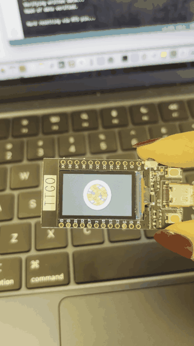
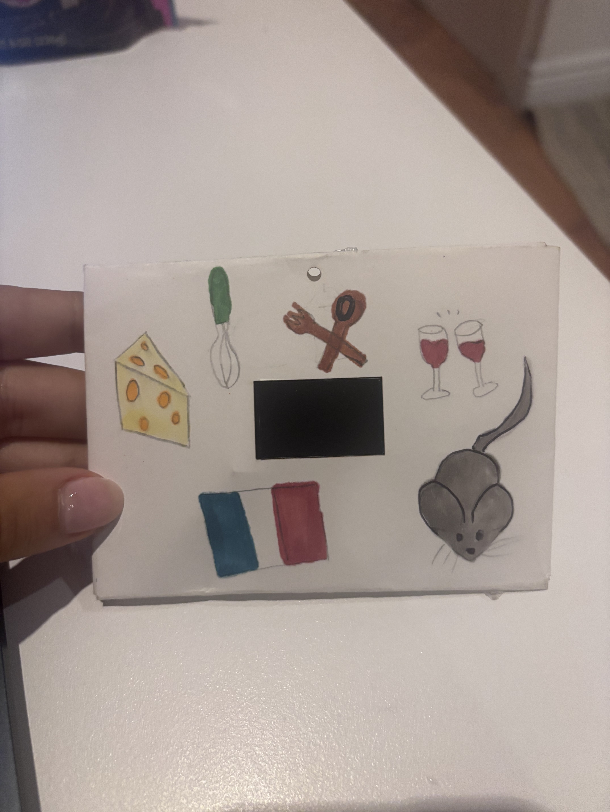

# A Taste of Memory

A generative animation for an ESP32 TTGO T-Display, inspired by the tasting flashback in *Ratatouille*. I am French, love cooking, and chose my favorite movie scene as a way to explore the connection between food and memory. A procedurally drawn plate, a bite, and golden sparks lead into a warm kitchen scene.



[Watch the video](https://youtube.com/shorts/eXNiJIZaBdE?feature=share) · [Project repository](https://github.com/siennaberreby/Module_1)

## Behavior and generative elements

The automatic loop lasts approximately 17.6 seconds: plate (6 s), bite (1.2 s), plate fade-out (1.3 s), kitchen fade-in (1.3 s), kitchen hold (6.5 s), and kitchen fade-out (1.3 s). No button or sensor input is required.

Every cycle regenerates the outer vegetable count (17–20), vegetable sizes and outer-ring radii, herb locations, bite position, and 14 spark trajectories. Steam and dust move using time-dependent sine functions. All graphics are drawn at runtime; the GIF is documentation only.

## Hardware

- Original ESP32 TTGO T-Display with a 135 × 240 ST7789 display, used in landscape orientation (240 × 135).
- USB-C **data** cable and a computer for programming and USB-powered demonstration.
- Compatible LiPo battery for the class installation; connect through the board’s battery connector using the correct polarity for the board.
- Paper envelope with a display opening and hanging hole, plus drawing materials.

The original TTGO T-Display and the T-Display S3 use different configurations. These instructions target the original ESP32 model used by this sketch. No external sensors or breadboard wiring are required.

## Software and display setup

1. Install Arduino IDE. Add the official ESP32 Boards Manager URL in Preferences if needed:
   `https://espressif.github.io/arduino-esp32/package_esp32_index.json`
2. In Boards Manager, install **esp32 by Espressif Systems**. Select the board entry matching your original TTGO T-Display; the manufacturer's Arduino instructions use **ESP32 Dev Module**, **PSRAM Disabled**, and **Flash Size 4MB**.
3. Install **TFT_eSPI by Bodmer** through Library Manager.
4. In the installed TFT_eSPI library, open `User_Setup_Select.h`. Disable the default `#include <User_Setup.h>` and enable only:
   ```cpp
   #include <User_Setups/Setup25_TTGO_T_Display.h>
   ```
   Only one display setup should be active. Recheck this selection after updating the library. The setup supplies the ST7789 driver and board pin definitions; the sketch enables the backlight on GPIO 4.
5. Download or clone this repository. Open `ratatouille_memory.ino` in Arduino IDE. If prompted, let Arduino IDE create a same-named folder for the sketch.
6. Connect the board with the USB data cable, select its serial port under Tools, and click Verify, then Upload.
7. After upload, the animation should start automatically. Observe at least two full cycles to see both the kitchen transition and changes in the regenerated plate.

The original author's exact Arduino IDE, ESP32 core, and TFT_eSPI versions were not recorded in the supplied materials. The instructions identify the required packages and board setup but are not a pinned, independently retested build environment.

Official references: [ESP32 Arduino installation](https://docs.espressif.com/projects/arduino-esp32/en/latest/installing.html), [LilyGO TTGO T-Display repository](https://github.com/Xinyuan-LilyGO/TTGO-T-Display), and [TFT_eSPI Setup25](https://github.com/Bodmer/TFT_eSPI/blob/master/User_Setups/Setup25_TTGO_T_Display.h).

## Physical presentation



The paper envelope has a rectangular opening for the display and a hole near the top for hanging. Cheese, utensils, wine glasses, a French flag, and a rat extend the cooking and film theme around the screen. Position the board behind the opening, secure it so it cannot slide, and leave access to power. For an untethered installation, use the compatible battery and keep the board and battery supported inside the envelope.

The photo documents the envelope design; the GIF documents the working screen outside the envelope.

## Code structure

| Function | Role |
| --- | --- |
| `vegetable()` / `makePlate()` | Draw layered vegetable slices and generate the plate |
| `drawKitchen()` | Draw the kitchen and animate steam and dust |
| `copyPlate()` | Copy the saved plate into the output buffer |
| `blend()` / `darkenFrame()` | Interpolate RGB565 colors for fades |
| `drawBurst()` | Draw sparks expanding from the bite |
| `newCycle()` | Reseed randomness and start a new variation |
| `loop()` | Select the current stage using elapsed time and display the frame |

Two 16-bit sprites store the plate and output frame, requiring about 129,600 bytes of pixel storage. Updates are limited to at most approximately 20 FPS by the 50 ms interval; rendering can lower the actual rate.

## Troubleshooting and customization

- **Library/core compile errors:** LilyGO’s repository recommends ESP32 core 2.0.14 for its bundled TFT_eSPI copy. If you use that bundled library, follow its version guidance; do not assume it has the same compatibility as the current Library Manager release.
- **Upload fails:** check the USB data cable, selected board, and serial port.
- **Backlight works but graphics do not:** check that TFT_eSPI uses Setup25 and no competing setup include is active.
- **Unexpected colors or orientation:** confirm the original T-Display hardware and matching display setup; the sketch uses `setRotation(1)`.
- **Animation looks identical:** watch multiple complete cycles. The story and kitchen layout are fixed; the randomized differences are deliberately subtle.

Adjust `PLATE_MS`, `BITE_MS`, `FADE_MS`, and `MEMORY_MS` to change pacing, or `SPARKS` to change the burst. Change the RGB values in `vegetable()` and `drawKitchen()` to explore other palettes. Increasing resolution or adding buffers increases memory use.

## Files

```text
Module_1/
├── README.md
├── ratatouille_memory.ino
├── demo.gif
└── envelope.jpg
```

## Credits

Project by Sienna Berreby for Module 1 of COMS BC3930: Creative Embedded Systems. Inspired by *Ratatouille* (Pixar, 2007). Uses Arduino, the Espressif ESP32 platform, and Bodmer's TFT_eSPI library.
